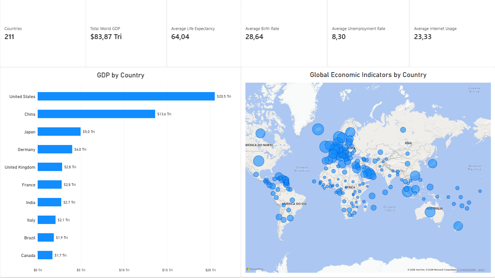
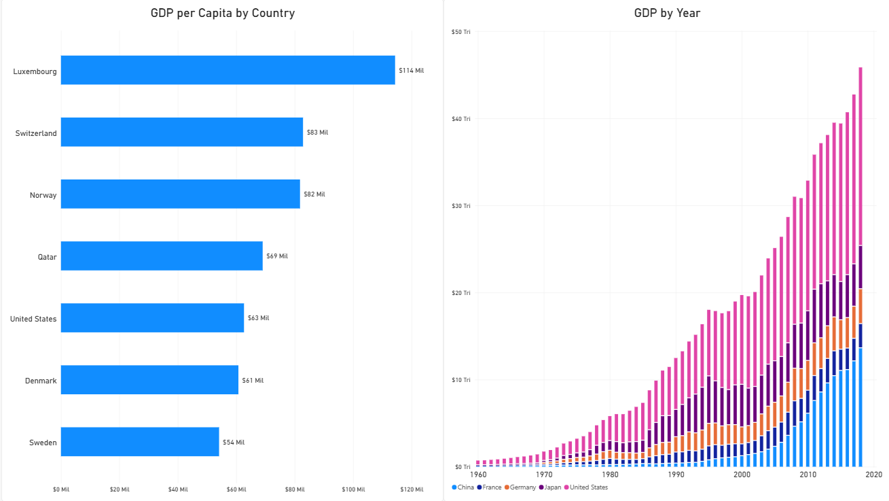
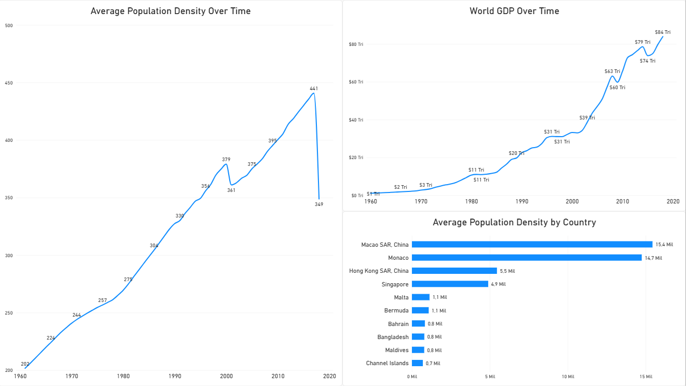
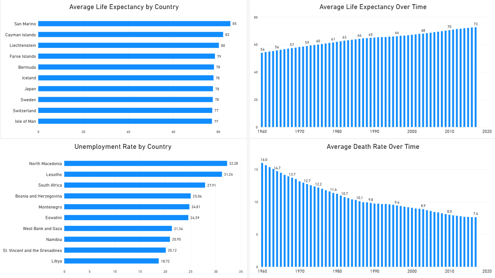
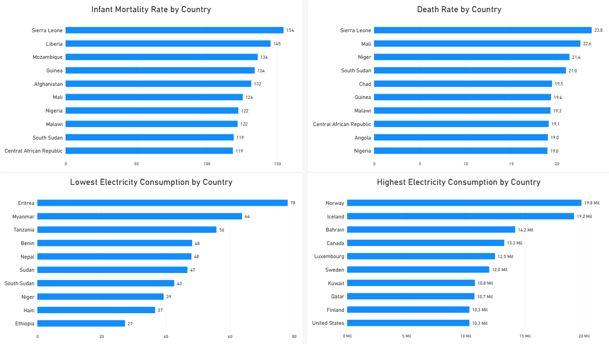
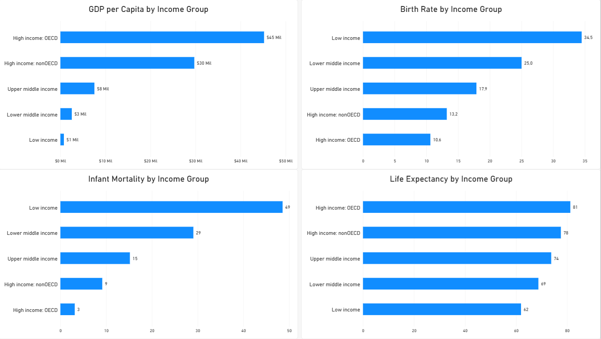
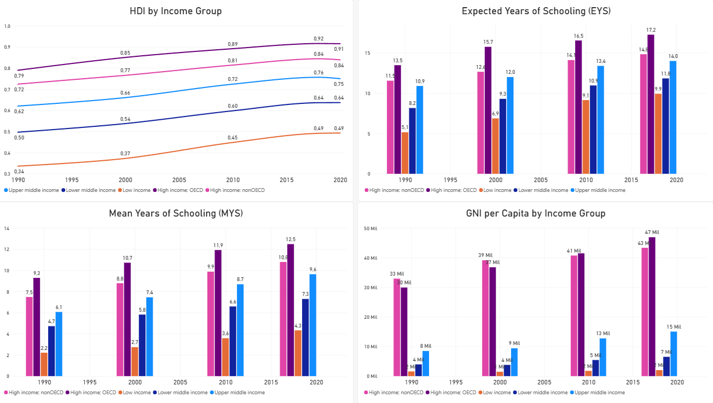

# World Economic Indicators

## Project Overview

This project explores global economic, demographic, and human development indicators using data from the World Bank and the United Nations Development Programme (UNDP).

The main goal is to identify global development patterns, compare countries across different income groups, and understand how economic and social indicators have evolved over time.

The analysis was developed using Microsoft Power BI, with data preparation in Power Query, data modeling, and DAX measures.

## Objectives

The project addresses four main analytical questions:

1. Which countries have experienced the highest growth in population and GDP? Is there overlap?
2. Which regions have experienced the greatest growth in the Human Development Index (HDI) during the 21st century?
3. Which factors are associated with life expectancy?
4. What factors differentiate high-income and low-income countries?

## Tools & Technologies

- **Power BI:** Data visualization, dashboards, and reporting.
- **Power Query:** Data cleaning, transformation, and preparation.
- **DAX:** Measures and analytical calculations.
- **Data Modeling:** Relationships and dimensional modeling.

## Data Sources

- World Bank – Development Indicators.
- United Nations Development Programme (UNDP) – Human Development Indicators.

## Project Structure

The Power BI report is organized into seven analytical pages:

| Page                                             | Description 
|---                                               |---
| Global Economic Overview                         | Overview of global economic indicators, including GDP, GDP per capita, and life expectancy. 
| Global Economic Overview Part. 2                 | Comparison of GDP per capita across countries and global GDP evolution. 
| Population & GDP Growth                          | Analysis of population density and global GDP trends over time. 
| Life Expectancy & Correlation                    | Exploration of life expectancy, unemployment, and death rates. 
| Life Expectancy & Correlation Pt. 2              | Analysis of infant mortality, death rates, and electricity consumption. 
| Income Group Analysis                            | Comparison of economic and demographic indicators across income groups. 
| Human Development                                | Analysis of HDI, education indicators, and GNI per capita across income groups. 

## Data Preparation & Modeling

The data preparation process included:

- Data cleaning and standardization.
- Handling missing values while preserving unavailable information.
- Data type corrections.
- Reshaping the Human Development Indicators dataset using unpivot transformations.
- Creating a country dimension table.
- Establishing relationships between the datasets using country codes.
- Developing DAX measures for analytical calculations.

## Key Findings

The analysis highlights several differences in economic and human development across countries and income groups:

- Global GDP increased considerably over the analyzed period.
- High-income countries generally present higher GDP and GNI per capita.
- Higher-income groups tend to have higher life expectancy and lower infant mortality rates.
- HDI improved across income groups between 1990 and 2018.
- Expected and mean years of schooling increased across the analyzed income groups.
- Significant development gaps remain between high-income and low-income countries.

---

## Dashboard Preview

### 1. Global Economic Overview

### 2. Global Economic Overview Part. 2

### 3. Population & GDP Growth

### 4. Life Expectancy & Correlation

### 5. Life Expectancy & Correlation Pt. 2

### 6. Income Group Analysis

### 7. Human Development

## Project Conclusion

For the complete project conclusion in English and Portuguese, see:

[World Economic Indicators - Project Conclusion](World-Economic-Indicators-Conclusion.md)

---

Project developed using Microsoft Power BI.
